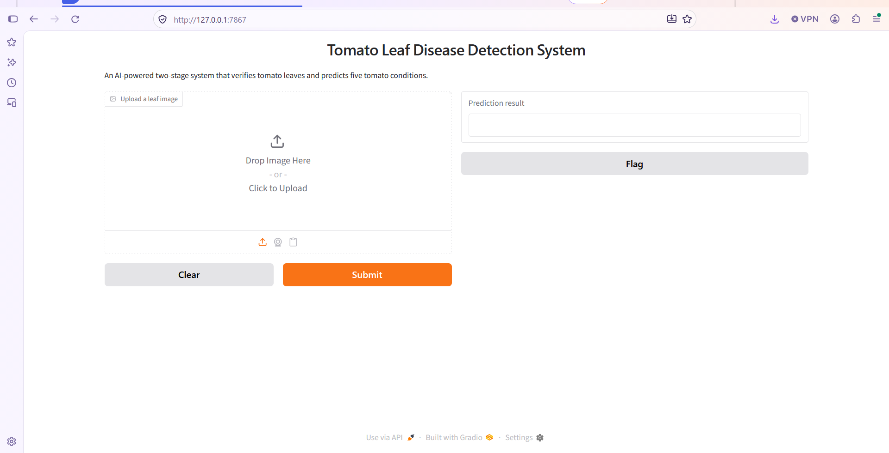
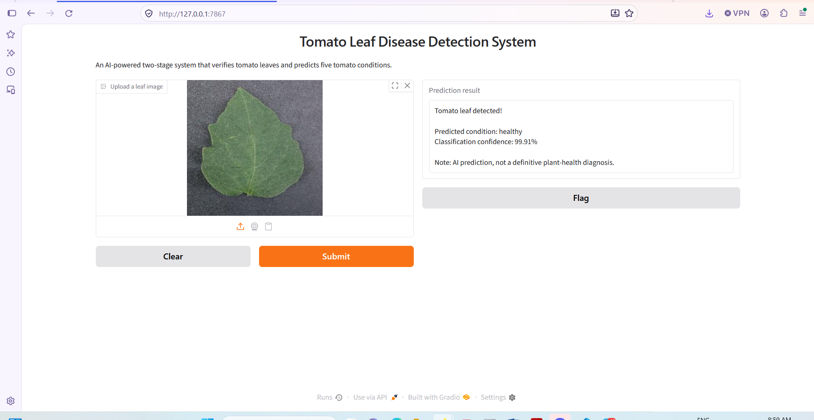
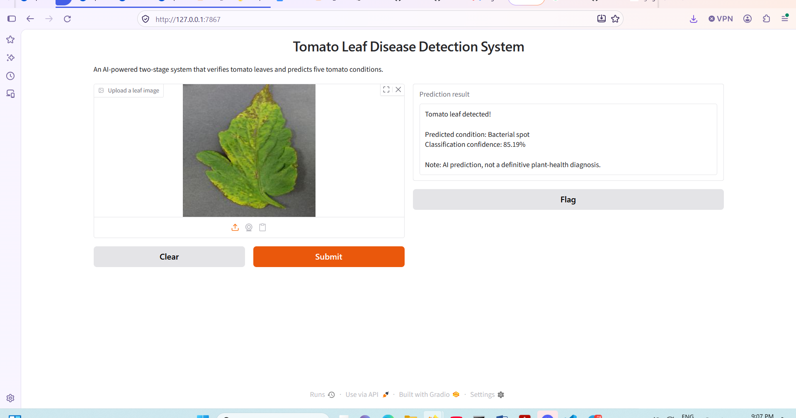

# Tomato Leaf Disease Detection System

An AI-powered tomato leaf disease detection application built with **PyTorch, Convolutional Neural Networks (CNNs), and Gradio**.

The system uses a two-stage deep-learning pipeline to verify tomato leaf images and classify them into five supported conditions.

## 1. Project Overview

Tomato plants are affected by several diseases that can reduce agricultural productivity. This project explores how deep learning and computer vision can help identify tomato leaf conditions from images.

The application accepts an image, checks whether it appears to be a tomato leaf, and then predicts its condition.

## 2. Key Features

- Two-stage image classification pipeline.
- Binary tomato-leaf verification model.
- Five-class tomato disease classification model.
- Image preprocessing using Torchvision.
- Confidence scores for predictions.
- Interactive Gradio web interface.
- Saved model checkpoints for inference without retraining.

## 3. Supported Classes

The disease classification model supports:

1. Tomato Bacterial Spot
2. Tomato Late Blight
3. Tomato Septoria Leaf Spot
4. Tomato Yellow Leaf Curl Virus
5. Tomato Healthy

**Note:** Conditions outside these five classes, including Early Blight, are not supported by the current disease classifier.

## 4. System Architecture

The application uses two CNN models in sequence.

### Stage 1: Tomato Leaf Verification

The first model determines whether an uploaded image appears to be a tomato leaf.

It has two output classes:
- Tomato Leaf
- Not Tomato Leaf

Images that do not pass the verification threshold are rejected.

### Stage 2: Disease Classification

Images accepted by the first model are passed to the second CNN, which predicts one of the five supported tomato conditions.

### Workflow

Image Upload → Image Preprocessing → Tomato Leaf Verification → Disease Classification → Prediction Result

## 5. Technologies Used

| Technology | Purpose |
|---|---|
| Python | Main programming language |
| PyTorch | Deep learning and CNN models |
| Torchvision | Image preprocessing |
| Gradio | Web application interface |
| Pillow | Image handling |
| Jupyter Notebook | Model development and experimentation |

## 6. Model Evaluation

The models were evaluated using held-out test datasets.

### Disease Classification Model

- Test accuracy: **98.20%**
- Number of test images: 1,276
- Correct predictions: 1,253

### Tomato Leaf Verification Model

- Test accuracy: **97.67%**
- Tomato acceptance rate: 98.59%
- Non-tomato rejection rate: 95.97%

### Combined Pipeline

| Evaluation | Result |
|---|---:|
| Total test images | 1,971 |
| Correct final outcomes | 1,903 |
| Overall accuracy | 96.55% |
| Correct tomato disease predictions | 1,236 |
| Correctly rejected non-tomato images | 667 |

These results represent the evaluated test datasets and should not be interpreted as a guarantee of performance on all real-world images.

## 7. Project Structure

```text
CropDiseaseDetection/
│
├── app/
│   └── app.py
│
├── src/
│   ├── models.py
│   └── prediction.py
│
├── models/
│   ├── tomato_cnn_final.pth
│   └── tomato_validator.pth
│
├── notebooks/
│   └── 01_dataset_exploration.ipynb
│
├── requirements.txt
├── .gitignore
└── README.md
```

## 8. Installation and Setup

### Requirements

- Python 3.12
- pip
- The saved model checkpoint files

### Step 1: Clone the repository

```bash
git clone YOUR_GITHUB_REPOSITORY_URL
```

```bash
cd CropDiseaseDetection
```

### Step 2: Install dependencies

```bash
pip install -r requirements.txt
```

### Step 3: Run the application

```bash
python app/app.py
```

### Step 4: Open the application

Open the local URL displayed in your terminal, usually:

```text
http://127.0.0.1:7860
```

Upload a tomato leaf image to receive a prediction.

## 9. Limitations

- The disease classifier supports only five tomato conditions.
- The verification model can incorrectly accept non-tomato images or reject genuine tomato leaves.
- Prediction confidence is not a guarantee of correctness.
- Performance may vary with lighting, image quality, background, and real-world image conditions.
- The system is an educational machine-learning application, not a replacement for professional agricultural diagnosis.

## 10. Future Improvements

- Expand the number of supported tomato diseases.
- Improve verification using more diverse real-world images.
- Explore transfer learning with pretrained CNN architectures.
- Improve model generalization and robustness.
- Deploy the application to a public hosting platform.

## 11. Author

Developed as a practical deep-learning and computer vision project using Python and PyTorch.

**Project:** Tomato Leaf Disease Detection System  
**Field:** Artificial Intelligence / Machine Learning  
**Framework:** PyTorch


*This project demonstrates the development, evaluation, and deployment of a two-stage deep-learning image classification system.*


## Application Screenshots

### 1. Application Interface


### 2. Healthy Tomato Prediction


### 3. Diseased Tomato Prediction

